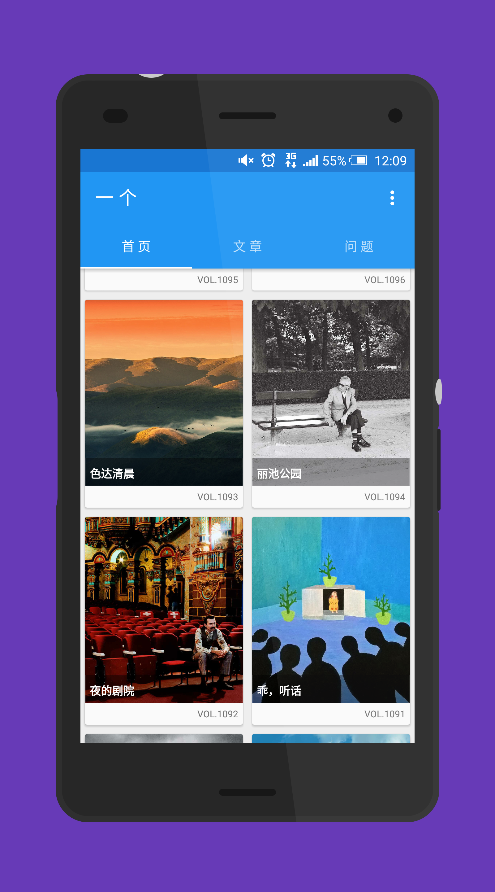
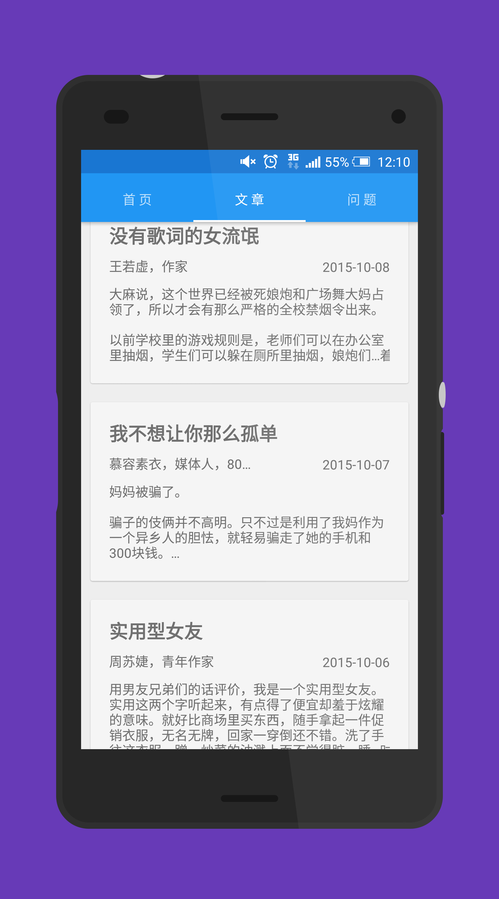
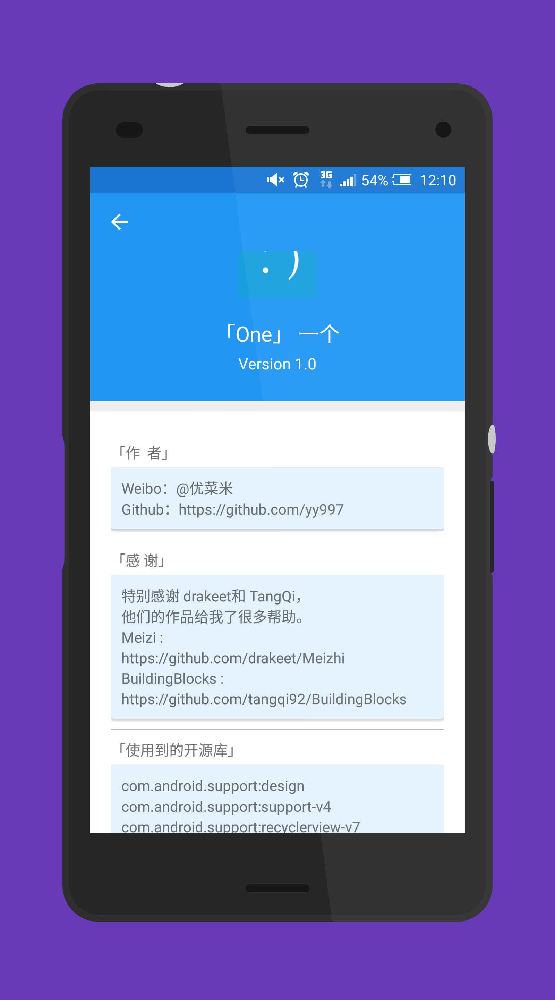
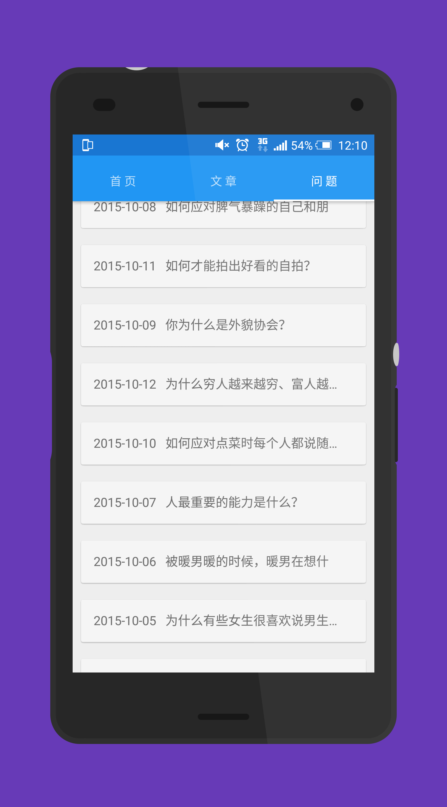

# One

韩寒「ONE · 一个」的第三方 Android 客户端。用三个标签浏览每天的首页图文、文章和问题，数据来自 ONE 当时公开的 HTTP 接口。项目写于 2015 年，最后一次功能更新在 2016 年。这个仓库现在做的是把工程整理到能在 JDK 17 上编译，并把文档写成和代码一致。

本项目与「ONE · 一个」及其运营方没有隶属关系。仓库里没有统计下载量或用户数，文档也不写这类数字。

## English

Unofficial Android client for Han Han's "ONE". Three tabs show the daily home picture, articles, and questions from the HTTP API used by this app since 2015. The app was last feature-updated in 2016. This tree is a maintenance pass: it builds with JDK 17, and the docs describe only behavior that is in the code. It is not affiliated with ONE. No download or user counts are tracked here.

## 功能

应用 id 是 `com.example.yang.yige`，`versionName` 为 `1.0`。启动后是标题「一 个」的主界面，底部三个标签由 `ViewPager` 承载，三个页面都会创建并各自请求数据。再按一次返回键的间隔是 3 秒，第一次会弹出 Snackbar「再按一次退出」。菜单里可以打开关于页。

### 首页

- 请求 `OneApi.getOneTodayHome`，解析 JSON 里的 `hpEntity`。
- 两列网格。卡片上是期号（`strHpTitle`，例如 VOL.1095）、缩略图和作品名（`strAuthor` 用 `&` 切开后的前半段）。
- 首次加载当天以及往前两天，一共 3 条；滑到底按日期再往前一天请求。
- 点击进入详情，Android 5.0 上使用共享元素过渡。
- 详情页展示标题、作者、正文和缩略图。正文按中文句号 `。` 分成正文和文末署名，正文里的逗号会换成换行。
- 点击缩略图打开大图。大图用 PhotoView 缩放，标题是「长按保存图片」，长按后确认再保存。
- 详情页的下载按钮保存原图。文件写到外部存储的 `One/ONE_yyyyMMdd_.jpg`，并插入系统相册，随后用 Snackbar 提示打开图片。
- 详情页的发送按钮分享当天首页接口地址（`getHp_N` 的 URL），使用系统分享面板。
- 下拉会收起刷新圈，并弹出 Snackbar「已经是最新的咯」。

### 文章

- 请求 `OneApi.getOneTodayArticle`。`strRow` 从 1 递增，首次取 3 篇，滑到底继续取。
- 列表显示标题、作者（按 `。` 取第一段）、日期（按空格取第一段）和正文。正文里的 `<br>` 会换成空格。
- 点击后用 WebView 打开接口返回的 `sWebLk`。加载过程有进度条。页面加载完成后注入脚本，隐藏 class 为 `header` 和 `footer` 的节点。
- 工具栏分享这篇文章的网页链接。

### 问题

- 请求 `OneApi.getOneTodayQuestion`，同样先取 3 条，再随滑动递增 `strRow`。
- 列表每一行是日期加标题。
- 点击后用 WebView 打开 `sWebLk`，并隐藏 `header`、`footer`、`download` 节点。
- 工具栏分享这个问题的网页链接。

`OneApi` 的注释写明：受当时 ONE 接口限制，文章和问答只能拿到最近十天。首页按日期逐天回溯，没有这句限制。

### 关于

关于页是折叠标题栏，内容来自 `strings.xml`：

- 作者：新浪微博 `@优菜米`
- 感谢 drakeet 的 Meizi 和 TangQi 的 BuildingBlocks
- 特别感谢 @_张大羊
- 一段开源库名单

布局里写死了 `Version 1.2`。Gradle 的 `versionName` 是 `1.0`。开源库名单里有 Picasso，工程依赖里没有 Picasso，图片加载用的是 Glide。

## 截图

下面四张图是仓库里原有的 `screenshots/`，来自当时的应用界面。

| 首页 | 文章 |
| --- | --- |
|  |  |

| 关于 | 问题 |
| --- | --- |
|  |  |

## 技术栈

| 项目 | 现在的取值 |
| --- | --- |
| 语言 | Java，源码与目标字节码 1.8，用 JDK 17 构建 |
| Gradle | 7.6.4 |
| Android Gradle Plugin | 7.4.2 |
| compileSdk | 33 |
| minSdk / targetSdk | 21 / 22 |
| Support Library | 22.2.1（design、support-v4、recyclerview-v7、cardview-v7） |
| 网络 | android-async-http 1.4.9，另声明 httpcore 4.4.1 |
| 图片 | Glide 3.5.2 |
| 缩放 | PhotoView 1.2.4，包名 `uk.co.senab.photoview` |
| 列表动画 | recyclerview-animators 1.2.0 |

依赖从 Google Maven 和 Maven Central 解析。原来的 `com.commit451:PhotoView:1.2.4` 不在 Maven Central（它以前在已经关闭的 jcenter）。现在使用 Maven Central 上的 `com.github.chrisbanes.photoview:library:1.2.4`，包名仍然是 `uk.co.senab.photoview`，布局和 Java 引用保持原样。

`targetSdk` 维持 22。接口是明文 HTTP，保存图片用的是旧的外部存储路径。把 `targetSdk` 提高到 28 及以上时，系统会默认禁止明文流量，并改用分区存储。这两件事都还没做。

接口基址写在 `OneApi`：

```text
http://rest.wufazhuce.com/OneForWeb/one/getHp_N?strDate={date}&strRow=1
http://rest.wufazhuce.com/OneForWeb/one/getC_N?strDate={date}&strRow={n}
http://rest.wufazhuce.com/OneForWeb/one/getQ_N?strDate={date}&strRow={n}
```

2026-10-21 在维护这个仓库的环境里探测过该主机：域名解析到 `198.18.0.1`，HTTP 请求超时，HTTPS 握手失败。这只说明当时这台机器没有连上，不能据此判断公网服务是否还在。装到手机上之前，请自己看这三个 URL 是否还有 JSON。

权限只有 `INTERNET` 和 `WRITE_EXTERNAL_STORAGE`。`minSdk` 是 21，存储权限在安装时授予。

## 构建

需要：

- JDK 17
- Android SDK Platform 33
- Android SDK Build-Tools 33.0.2

SDK 位置用环境变量 `ANDROID_SDK_ROOT`（或 `ANDROID_HOME`）。也可以在仓库根目录写 `local.properties`，这个文件已经在 `.gitignore` 里：

```properties
sdk.dir=/path/to/android/sdk
```

然后：

```bash
./gradlew assembleDebug --no-daemon --max-workers=2
```

`gradle.properties` 中有 `org.gradle.jvmargs=-Xmx1536m`。调试 APK 在 `app/build/outputs/apk/debug/app-debug.apk`。`assembleRelease` 关闭了混淆（`minifyEnabled false`），也没有配置签名，产物是 `app/build/outputs/apk/release/app-release-unsigned.apk`。

`assembleDebug` 不编译 `androidTest`。那里的 `ApplicationTest` 仍继承 `android.test.ApplicationTestCase`，这个类在新的 `android.jar` 里已经没有了。

## 项目结构

```text
app/src/main/java/com/example/yang/yige/
  activity/     主界面、首页详情、大图、文章 WebView、问题 WebView、关于
  fragment/     首页、文章、问题三个标签
  adapter/      三个列表的 RecyclerView 适配器
  listener/     滑到底加载
  model/        Daily、Article、Question
  utils/        OneApi、JSON 解析、日期、保存图片、Snackbar
app/src/main/res/
  layout/       界面对应的布局
  menu/         关于、分享
screenshots/    上表使用的四张原图
```

主界面布局的根节点是 `DrawerLayout`，侧栏 `NavigationView` 整段被注释掉了，界面上没有抽屉菜单。

## 已知限制

- 首页下拉只提示已经是最新，不会重新请求。
- 首页详情用 `&` 和 `。` 切分作者与正文。字段缺失或分隔符不在时，会在 `split` 结果上越界。
- 同一天多次保存图片时，文件名都是 `ONE_yyyyMMdd_.jpg`，后一次覆盖前一次。
- WebView 里隐藏顶栏和底栏的脚本直接取 `getElementsByClassName(...)[0]`。页面上没有这些节点时，脚本会在页面里报错。
- 关于页的版本号、开源库名单和 Gradle 依赖不一致，见上文。
- 文章和问题的分页没有在客户端设上限，源码注释说接口只有最近十天。
- 仪器测试还不能在当前 SDK 上编译。

## Roadmap

下面是后续可以做的事，都还没有做。

- 在能访问公网的环境里确认三个 ONE 接口是否仍返回 `hpEntity`、`contentEntity`、`questionAdEntity`。确认失效之后，再换数据源。
- 迁移到 AndroidX，并把 Support Library 22.2.1 换掉。
- 提高 `targetSdk`。同时加上明文 HTTP 的网络安全配置、分区存储，以及 Android 6 及以上需要的运行时存储权限。
- 用仍在维护的 HTTP 客户端替换 android-async-http 1.4.9。
- 让首页下拉重新请求当天数据。
- 关于页版本号改为读取 `versionName`，开源库名单与 `app/build.gradle` 对齐。
- 保存图片时使用带时分秒的文件名，避免同一天互相覆盖。
- 首页详情在切分文案之前检查空值和分隔符。
- WebView 注入脚本时跳过不存在的节点。
- 重写 `androidTest`，去掉 `ApplicationTestCase`。

## 贡献

见 [CONTRIBUTING.md](CONTRIBUTING.md)。Bug 和功能建议请用 Issues 里的模板。

## License

[MIT](LICENSE)。Copyright (c) 2015-2026 Mickey Yang。
